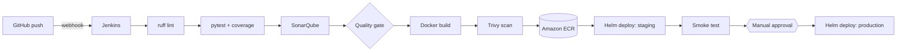

# Jenkins CI/CD to Amazon EKS: TaskFlow API

A Python **FastAPI** service delivered by a **Jenkins** pipeline: lint, unit tests with coverage, **SonarQube** quality gate, Docker build, **Trivy** scan, push to **Amazon ECR**, **Helm** deploy to a staging namespace on **EKS**, automated smoke test, then a **manual approval** before production. Triggered by **GitHub webhooks**. Infrastructure is **Terraform**.

This is push-based delivery (Jenkins runs `helm upgrade`). Compare with the GitOps approach in [devsecops-streaming-eks](https://github.com/siphosem/devsecops-streaming-eks).

## Pipeline



## Highlights

- **Tested API**: CRUD task tracker with validation, Prometheus `/metrics`, 100% line coverage.
- **Gates that stop bad builds**: ruff, failing tests, SonarQube quality gate, HIGH/CRITICAL fixable CVEs.
- **Safe releases**: Helm `--atomic` rolls back automatically if pods don't become ready; staging smoke test hits the real service; production needs a human click.
- **Production-ready chart**: rolling updates with zero unavailable pods, HPA, PodDisruptionBudget, probes, resource limits, non-root, read-only root filesystem, all capabilities dropped.
- **No stored cloud secrets**: Jenkins uses its EC2 instance role; an **EKS access entry** grants it cluster access. ECR push is scoped to one repository.
- **ECR hygiene**: immutable tags, scan on push, lifecycle policy keeps the last 20 images.

## Layout

```
app/                FastAPI service
tests/              pytest suite
Dockerfile          multi-stage, non-root
Jenkinsfile         pipeline
helm/taskflow/      chart + staging/production values
terraform/          VPC, EKS (with Jenkins access entry), ECR, Jenkins EC2
scripts/            Jenkins bootstrap user data
```

## Run it

**Prerequisites:** AWS account and CLI, Terraform ≥ 1.6, kubectl, Helm.

```bash
# 1. Infrastructure
cd terraform
terraform init
terraform apply -var='allowed_cidrs=["<your-ip>/32"]'
$(terraform output -raw configure_kubectl)

# 2. Metrics server (needed by the HPA)
helm repo add metrics-server https://kubernetes-sigs.github.io/metrics-server/
helm upgrade --install metrics-server metrics-server/metrics-server -n kube-system
```

3. **Configure Jenkins** at the `jenkins_url` output:
   - Unlock it: `aws ssm start-session --target <jenkins_instance_id>` then `sudo cat /var/lib/jenkins/secrets/initialAdminPassword`.
   - Plugins: SonarQube Scanner, Docker Pipeline, GitHub, Pipeline: Multibranch, Timestamper, JUnit.
   - **Tools**: SonarQube Scanner named `sonar-scanner`.
   - **SonarQube** at `sonarqube_url`: change the admin password, generate a token, add a webhook to `http://<jenkins-private-ip>:8080/sonarqube-webhook/`. In Jenkins **System → SonarQube servers**: name `sonarqube`, URL `http://localhost:9000`, token as a Secret text credential.
   - **New Item → Multibranch Pipeline** pointing at this GitHub repo.
4. **GitHub webhook**: Settings → Webhooks → `http://<jenkins-public-ip>:8080/github-webhook/`, JSON, push events. GitHub's hook IP ranges must be in `allowed_cidrs`; otherwise use periodic branch scanning.
5. Push to `main`, watch staging deploy, then approve production. Get the production URL with `kubectl -n production get svc taskflow`.

### Run locally

```bash
python3 -m venv .venv && . .venv/bin/activate
pip install -r requirements-dev.txt
pytest
uvicorn app.main:app --reload   # docs at http://localhost:8000/docs
```

## Cost and cleanup

About **US$7–9 per day** (EKS control plane, two t3.medium nodes, t3.large Jenkins, NAT gateway, one load balancer).

```bash
helm uninstall taskflow -n production; helm uninstall taskflow -n staging
sleep 60   # let AWS delete the load balancer
terraform -chdir=terraform destroy
```

## Screenshots

<!-- Add after deploying: Jenkins stage view with the approval step, SonarQube dashboard, ECR images with scan results, kubectl get all -n production, the /docs page. -->

## What I learned

<!-- 3-5 bullets in your own words. -->
